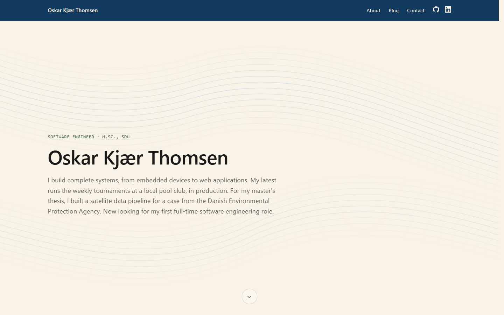

# Portfolio Website

My personal portfolio, live at **[oskar.kjaer-thomsen.dk](https://oskar.kjaer-thomsen.dk)**: a
server-rendered ASP.NET Core application backed by Entity Framework Core and SQL Server.

Write-up: **[Building This Portfolio Website in ASP.NET Core](https://oskar.kjaer-thomsen.dk/blog/building-this-portfolio-website)**



## Why ASP.NET Core

A portfolio could be a single static HTML page. The roles I'm applying for work with C#, .NET
and SQL Server, so instead of only listing those technologies, I built the portfolio itself with
them. It's my first project in that stack.

## Stack

- **ASP.NET Core 10** with Razor Pages: every page is rendered on the server, with no SPA
  framework
- **Entity Framework Core 10** as the data layer, with schema changes as migrations
- **SQL Server 2022** (Express edition) in Docker
- **Plain CSS** and a 48-line JavaScript file: no frontend build step, npm packages or web fonts
- **Docker Compose** to run the app and the database, and **Caddy** for HTTPS in production

## How the content works

Projects, skills and blog posts are EF Core entities stored in SQL Server, not hardcoded in the
markup. A blog post can point to a project, which links the two on the site.

All content is defined in [`SeedData.cs`](src/Portfolio.Web/Data/SeedData.cs), which is the
source of truth. On every startup the app applies pending migrations and then syncs the database
with that file: changed items are updated, new ones added, and removed ones deleted. Editing a
post is a code change and a redeploy, and the database never needs backing up, because an empty
one is rebuilt at the next start.

## Running it locally

Requires Docker, and the .NET 10 SDK for `dotnet run`.

```sh
cp .env.example .env
docker compose up -d --build      # the app on http://localhost:8090, with SQL Server
```

For development, run only the database in Docker and the app with `dotnet run`:

```sh
docker compose up -d sqlserver
cd src/Portfolio.Web
dotnet run --launch-profile http  # http://localhost:5101
```

## Project structure

```
src/Portfolio.Web/
  Program.cs          Startup: services, migrations and content sync, middleware
  Data/               DbContext and SeedData.cs (all site content)
  Models/             Project, Skill, BlogPost and their child entities
  Pages/              Razor Pages: home, about, contact, blog
  Migrations/         EF Core migrations
  wwwroot/            CSS, JavaScript, icons and blog images
Dockerfile            Multi-stage build: .NET SDK to publish, ASP.NET runtime to run
docker-compose.yml    The app and SQL Server
```

## Deployment

The `production` branch is what the server runs. It adds `docker-compose.prod.yml`, which
publishes no ports and puts the app on a Docker network shared with a Caddy reverse proxy. Caddy
serves this site and my [pool tournament platform](https://github.com/OKThomsen/pool-tournament-app)
from the same server, with HTTPS certificates from Let's Encrypt. Deploying is a merge of `main`
into `production`, then `git pull && docker compose up -d --build` on the server.

More detail, including the data model, is in [DOCUMENTATION.md](DOCUMENTATION.md); the server
setup is documented there on the `production` branch.
